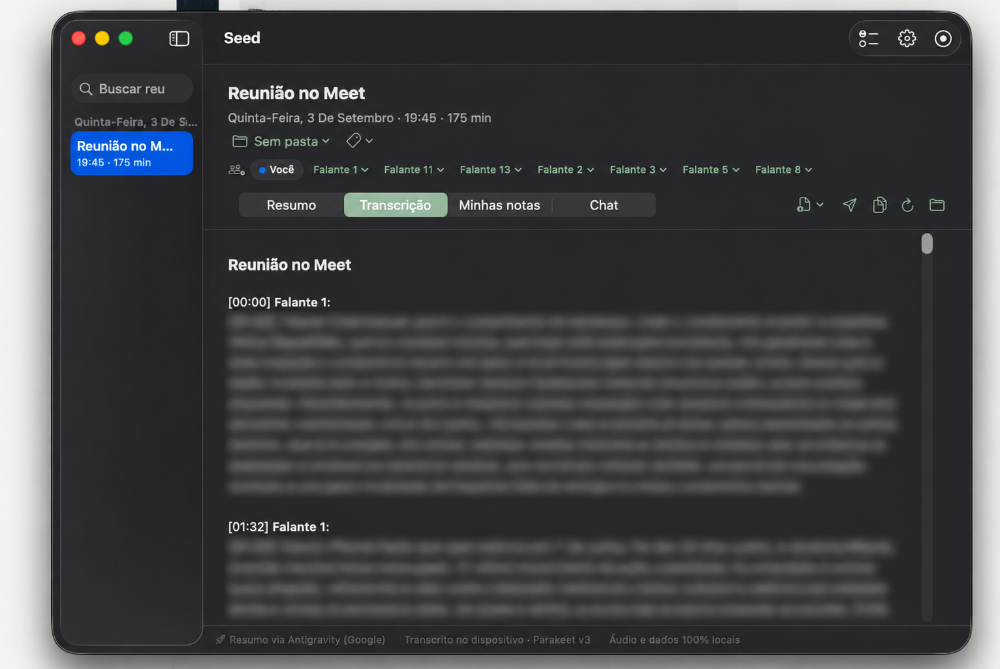
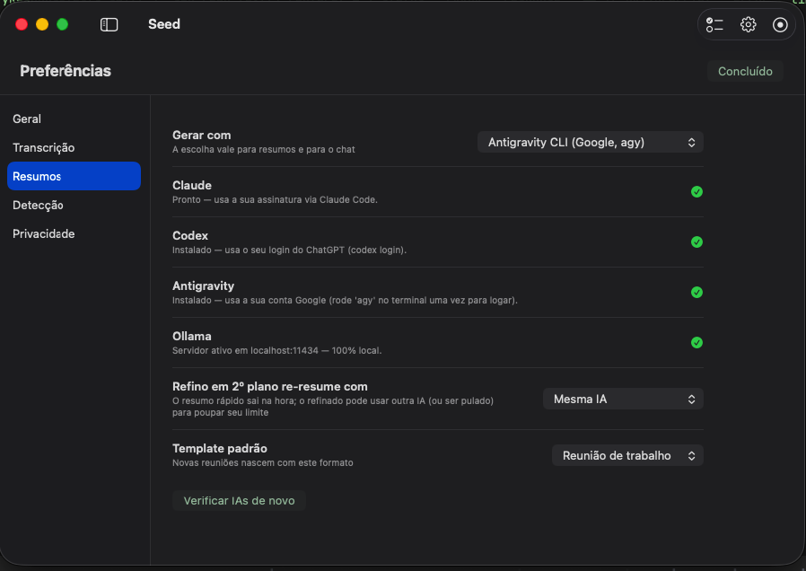
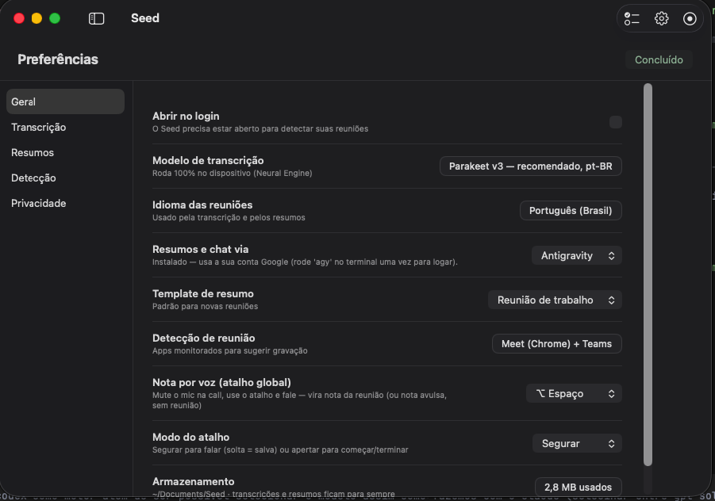
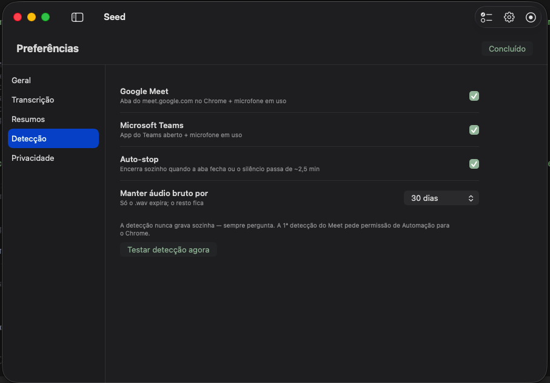
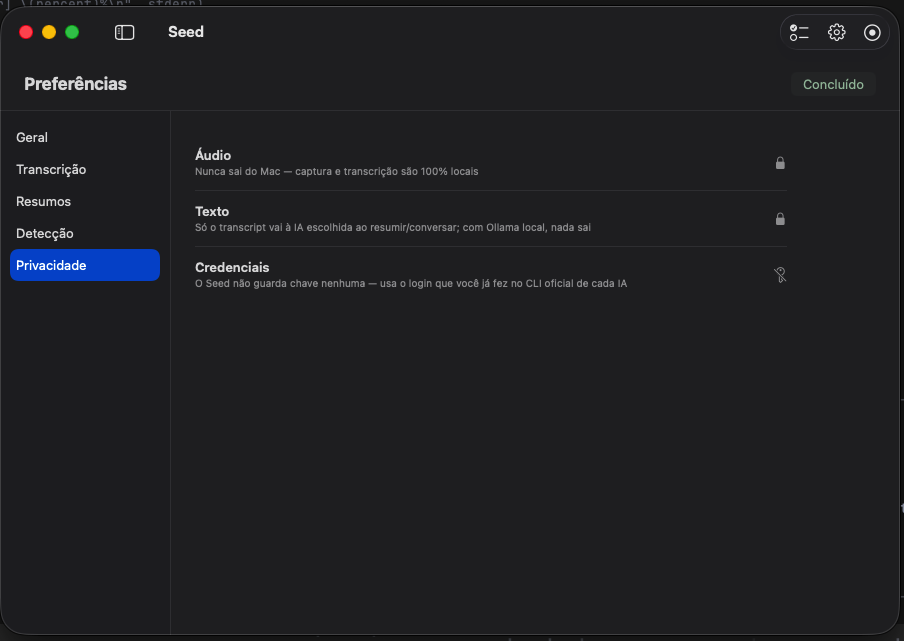

# Seed Meetings 🌱

Grave reuniões no Mac, acompanhe a transcrição, anote ideias e converse com o que foi discutido — durante a chamada ou depois dela. O Seed é um app nativo para macOS, sem bot na reunião, com transcrição local e escolha do motor de IA para resumos e chat.

[Instalação](#instalação) · [Motores de IA](#configure-um-motor-de-ia) · [Como usar](#como-usar) · [Privacidade](docs/PRIVACY.md) · [Solução de problemas](docs/TROUBLESHOOTING.md)



## Funcionalidades

| Recurso | Como funciona |
| --- | --- |
| Gravação sem bot | Captura o microfone e o áudio reproduzido no Mac em trilhas separadas. Nenhum participante artificial entra na chamada. |
| Transcrição local | Parakeet TDT v3, via FluidAudio/Core ML. O áudio é processado no dispositivo. |
| Transcrição ao vivo | Blocos aparecem durante a reunião, conforme as pausas da fala e o tempo de processamento. |
| Separação de pessoas | A diarização agrupa vozes em “Falante 1”, “Falante 2”… Sua trilha de microfone aparece como “Você”. |
| Memória de vozes | Confirme nomes em “Quem é quem”. O app aprende localmente e sugere ou associa nomes em reuniões seguintes. É uma estimativa; associações podem ser corrigidas e falantes podem ser mesclados. |
| Notas em tempo real | Escreva em “Minhas notas” enquanto grava. As notas orientam o resumo, que complementa os pontos com a transcrição. |
| Notas por voz | Atalho global configurável, em modo segurar ou apertar para iniciar/parar. O ditado vira nota com marca de tempo; sem reunião, vira nota avulsa do dia. |
| Chat durante a reunião | Pergunte “o que perdi nos últimos 5 minutos?” ou “qual foi o prazo?”. Usa a transcrição parcial e as notas disponíveis naquele momento. |
| Chat depois da reunião | Pergunte sobre decisões, responsáveis e pendências. Usa resumo, notas, transcrição e histórico recente; a conversa ao vivo continua na mesma reunião. |
| Vários motores de IA | Claude Code, Codex CLI, Antigravity CLI e Ollama. A escolha vale para resumo, chat e follow-ups. |
| Modelos selecionáveis | Claude: Sonnet, Opus, Haiku ou padrão da conta. Codex: GPT-5.6 Sol, Luna (Lua), Terra, GPT-6 Astra ou padrão do CLI. Ollama: nome do modelo instalado. |
| Resumos na tela | O conteúdo final é exibido na aba Resumo. Respostas que apenas entregam um link são rejeitadas pelo validador de formato e têm uma nova tentativa. |
| Templates | Trabalho, 1:1, entrevista, aula e brainstorm. É possível gerar novamente com outro formato. |
| Refino em segundo plano | Ao terminar, produz um resultado inicial e refina a transcrição/diarização. O novo resumo pode usar o mesmo motor, outro motor ou ser pulado. |
| Dicionário pessoal | Cadastre grafias corretas, variantes e notas. Corrige variantes registradas na transcrição e fornece contexto à IA. Começa vazio. |
| Detecção de reunião | Reconhece Meet no Chrome e Microsoft Teams com microfone em uso; oferece Gravar/Ignorar. Não começa a gravar sem confirmação. |
| Parada automática | Pode encerrar ao sair da chamada ou após silêncio prolongado. Configurável. |
| Organização | Busca em títulos e conteúdo, pastas, tags, renomeação e acesso à pasta de arquivos de cada reunião. |
| Follow-ups e tarefas | Gera rascunhos para compartilhar e consolida suas pendências recentes. Não envia mensagens automaticamente. |
| Integração MCP | Servidor incluído no app (0.2.1+): agentes consultam resumos, transcrições paginadas e trechos de áudio via MCP. |
| Controles do Mac | App na barra de menus, indicador flutuante, abertura no login e seleção de microfone. |
| Retenção | Expiração configurável do áudio bruto; transcrições, resumos e notas continuam armazenados. |

## Instalação

### Requisitos

- Mac com Apple Silicon (M1 ou mais recente), macOS 14.4 ou superior. O pacote distribuído é arm64; Intel não foi validado.
- Espaço livre para os modelos de reconhecimento e as gravações. A primeira transcrição precisa de internet para baixar os modelos; o tamanho varia conforme os modelos usados.
- Um dos motores abaixo para resumo/chat. Captura e transcrição não exigem assinatura de IA.
- Para compilar: Xcode ou Command Line Tools com Swift 6 e Git.

### App pronto

Baixe `Seed-Meetings-macOS-arm64.zip` em [Releases](https://github.com/dspinillo/seed-meetings/releases), descompacte e mova `Seed.app` para Aplicativos. Instale e autentique pelo menos um motor de IA antes de usá-lo para resumir ou conversar.

O pacote comunitário não é notarizado pela Apple. Se o macOS bloquear a abertura, confira a origem e o checksum da release e siga [a orientação da Apple para abrir apps de desenvolvedores não identificados](https://support.apple.com/guide/mac-help/open-a-mac-app-from-an-unknown-developer-mh40616/mac). Não é necessário desativar o Gatekeeper.

### Compilar a partir do código

```bash
xcode-select --install
git clone https://github.com/dspinillo/seed-meetings.git
cd seed-meetings
make app
open dist/Seed.app
```

A compilação baixa a dependência FluidAudio e gera o bundle. Opcionalmente, antes de `make app`, execute `./scripts/make-cert.sh` para criar **seu próprio** certificado local “Seed Dev”, preservando as permissões entre recompilações. O script pode pedir acesso ao Chaves; nenhuma chave privada acompanha o repositório.

## Configure um motor de IA

**Instalar o app de chat ou o editor não garante que o CLI esteja instalado.** O Seed procura os comandos no Mac e usa a autenticação que você fez neles. Não há conta, token ou assinatura incluídos no download. O uso segue os limites, planos, políticas e eventual cobrança do fornecedor; a disponibilidade de cada modelo depende da sua conta.

| Motor | Instalação e login | Seleção no Seed |
| --- | --- | --- |
| Claude Code | Siga o [guia oficial](https://code.claude.com/docs/en/quickstart), depois execute `claude` e conclua o login. | Preferências → Resumos → Claude; selecione Sonnet, Opus, Haiku ou o padrão da conta. |
| Codex CLI | Siga o [guia oficial](https://developers.openai.com/codex/cli), depois execute `codex login`. Uma opção de instalação é `npm install -g @openai/codex`. | Preferências → Resumos → Codex; selecione Sol, Luna, Terra, Astra ou o padrão do CLI. |
| Antigravity CLI | Siga [Installation & Auth](https://antigravity.google/docs/cli/install/), execute `agy` e entre na conta Google. Atualize com `agy update`. | Preferências → Resumos → Antigravity. O modelo segue a configuração do CLI. |
| Ollama | Instale pelo [site oficial](https://ollama.com/download), abra o Ollama e baixe um modelo, por exemplo `ollama pull qwen3`. | Preferências → Resumos → Ollama; informe o nome do modelo. O servidor deve estar ativo em `localhost:11434`. |

Use CLIs atuais. A integração Codex precisa de `exec`, `--model`, `--ephemeral` e `--output-last-message`; a integração Antigravity precisa de entrada e saída `stream-json`. Veja [Codex não interativo](https://developers.openai.com/codex/noninteractive), [catálogo de modelos OpenAI](https://developers.openai.com/api/docs/models) e [Antigravity headless](https://antigravity.google/docs/cli/headless/).

Em **Verificar IAs de novo**, o indicador mostra a presença do CLI ou servidor. Isso não verifica login, saldo, cota nem acesso a cada modelo. Faça um primeiro teste com conteúdo fictício.



As capturas ilustram o layout; o seletor de modelos do Codex foi acrescentado após essas imagens.

## Como usar

1. Abra o Seed. Autorize o microfone e a captura de áudio do sistema quando o macOS solicitar. Para detectar Meet no Chrome, autorize também Automação do Chrome.
2. Entre numa reunião e aceite a sugestão **Gravar**, ou inicie manualmente pelo app. O Seed deve permanecer aberto para detectar chamadas.
3. Acompanhe a transcrição e escreva em **Minhas notas**. Abra o chat ao vivo para consultar o que já foi transcrito. “Ao vivo” se refere ao contexto atualizado; a resposta aparece ao terminar a geração, não token a token.
4. Para ditar uma nota, use o atalho definido em Preferências → Geral (padrão: **⌥ Espaço**, segurar). **Silencie seu microfone na chamada antes de ditar**: o Seed omite esse trecho da própria trilha da reunião, mas não controla o mute do Meet/Teams. Se o reconhecimento falhar, conserva o áudio da nota para recuperação.
5. Pare a gravação. O resumo aparece na tela; acompanhe o refino em segundo plano. Confirme os nomes dos participantes e gere novamente quando necessário.
6. Consulte o chat, copie o resumo, organize a reunião ou gere um rascunho de follow-up.

### Dicionário e participantes

Em **Preferências → Transcrição → Dicionário particular**, use **Adicionar termo**, preencha a grafia correta e, opcionalmente, as variantes separadas por vírgula e uma nota. As mudanças são salvas automaticamente. O dicionário influencia novas transcrições e novas gerações; para conteúdo antigo, reprocese ou gere novamente conforme a alteração.

Os nomes de falantes são estimados por voz e pelo contexto. Revise “Quem é quem” antes de confiar em atribuições de decisões ou tarefas. Ruído, vozes sobrepostas e microfones compartilhados podem juntar ou separar pessoas incorretamente.

### Refino e retenção

Em **Preferências → Resumos**, escolha o motor para o refino em segundo plano. **Não refazer o resumo** conserva o resumo inicial e evita uma segunda geração; a transcrição ainda pode ser refinada.

Em **Preferências → Detecção**, configure Meet/Teams, auto-stop e retenção. A limpeza remove os arquivos de áudio bruto reconhecidos pelo app; textos e arquivos de recuperação de notas por voz devem ser gerenciados separadamente. Excluir uma reunião remove sua pasta.

<details>
<summary>Mais telas</summary>





As telas são demonstrativas. Consulte a [política de privacidade técnica](docs/PRIVACY.md) para o fluxo completo de dados; modelos cloud do Ollama e CLIs podem ter seus próprios registros.
</details>

## Privacidade e instalação limpa

Uma instalação nova começa sem reuniões, glossário, notas, nomes de pessoas ou memória de vozes. Não há credenciais nem dados de usuário no bundle. Atualizar o app preserva os dados que **você** já possui em `~/Library/Application Support/Seed`; reinstalar não apaga essa pasta.

O áudio é transcrito localmente. Ao pedir resumos, chat ou follow-ups a um motor remoto, o Seed envia o contexto necessário: transcrição, notas, glossário, resumo e/ou histórico recente. Os CLIs têm suas próprias configurações, registros e políticas. Para processamento de texto no dispositivo, escolha um **modelo local** do Ollama. A pasta de dados não é criptografada pelo app; backups e sincronização de Documentos, se configurados no macOS, também podem copiá-la.

Leia [Privacidade e armazenamento](docs/PRIVACY.md) e [Segurança](SECURITY.md). Informe os participantes e observe as regras aplicáveis ao seu uso de gravações.

## Desenvolvimento e MCP

```bash
make app       # app de produção
make cli       # CLI de diagnóstico
make test      # testes locais, sem chamadas pagas aos motores
```

Veja [Desenvolvimento](docs/DEVELOPMENT.md) para arquitetura, testes reais dos motores, publicação e uso de um diretório de dados isolado. Veja [MCP](docs/MCP.md) para conectar clientes externos. A integração MCP é opcional e dá ao cliente acesso aos textos e aos áudios locais. O servidor já acompanha o app em `Seed.app/Contents/MacOS/seed-mcp`. Veja os comandos de conexão com Codex/Claude Code e exemplos de consultas no [guia MCP](docs/MCP.md).

## Limitações

- Versão inicial para macOS; não há app Windows/Linux, sincronização própria ou editor colaborativo.
- Detecção automática tem suporte específico a Meet no Chrome e Teams. A gravação manual pode capturar áudio de outros apps.
- Transcrição, diarização e IA podem errar. Revise conteúdo e atribuições antes de compartilhar.
- O motor tem até cinco minutos por chamada. Respostas de resumo com formato inválido têm uma segunda tentativa; falha persistente é exibida e não substitui um resumo salvo.
- Uma reunião longa pode exceder a janela de contexto ou a cota do modelo. Se necessário, troque o modelo ou reduza o material.
- Os CLIs podem mudar. Atualize-os e consulte a solução de problemas se uma integração deixar de funcionar.

## Licença e créditos

[MIT](LICENSE). Usa [FluidAudio](https://github.com/FluidInference/FluidAudio) para reconhecimento e diarização. Modelos e ferramentas de terceiros mantêm suas próprias licenças e condições de uso. Seed Meetings é um projeto independente.
